# ⭐ PENETRATION TESTING REPORT ⭐
## ⚠️ FOOTPRINTING & NETWORK SCANNING PHASES ⚠️ 

**W2-PM-FINAL | CYBERSECURITY | NETWORKWALKS**

---

## Project Information 💻

| Field | Details |
|---|---|
| **Pentester Name** | Nandhita Mahato |
| **Program / Batch** | B084 – Networkwalks |
| **Date** | 12 November 2026 |
| **Modules Completed** | W2-PM1 (Multiple Kali Tools), W2-PM4 (theHarvester), W2-PM5 (Zenmap Scanning) |
| **Client / Target** | Networkwalks (authorized practical) and my own local LAN network; Microsoft.com for the assigned theHarvester OSINT exercise |
| **Permission Secured** | Yes, for the authorized target and own local network |
| **Phases Covered** | Phase 1: Reconnaissance & Footprinting; Phase 2: Scanning & Network Discovery |

---

# 1. Liability Disclaimer 🔐

I have performed these activities only on systems and devices where I had secured written permission or on devices and systems that I own myself. All materials are for educational and research purposes only.

Do not use anything from this report to break the law. The instructor, authors, and Networkwalks are not responsible for how this knowledge is used. Every action taken is my own responsibility.

Misuse can lead to criminal charges, heavy fines, loss of employment, and a permanent record. In most countries, unauthorized access is a crime, even when no damage is caused.

# 2. Introduction 🌐

This report covers the practical activities performed during Week 2 of my Cybersecurity and Ethical Hacking internship at Networkwalks.

The activities included:

- **W2-PM1 – Footprinting with Multiple Kali Tools:** Used six Kali Linux tools to collect publicly available information about the `networkwalks.com` domain.
- **W2-PM4 – theHarvester Footprinting:** Used theHarvester to gather publicly available email addresses, subdomains, and host information related to `microsoft.com`.
- **W2-PM5 – Network Scanning with Zenmap:** Scanned my own local network to discover live hosts and identify their IP and MAC addresses.

These exercises helped me understand how reconnaissance and footprinting collect information about a target before further security testing, while network scanning helps identify active devices within a network.

The commands were executed using Kali Linux for the footprinting activities and Windows with Zenmap installed for the local network scanning activity. The findings and supporting evidence are documented in the following sections.

# 3. Tools Used 🛠️

| Tool | Purpose |
|---|---|
| Kali Linux | Operating system used for footprinting and reconnaissance |
| Windows | Operating system used for local network identification and scanning |
| WHOIS | Finds domain registration information, including registration dates and name servers |
| WhatWeb | Identifies website technologies, server details, CMS platforms, and plugins |
| Nslookup | Resolves a domain name to its IP address using DNS |
| Curl (`-I`) | Retrieves HTTP response headers from a website |
| Wafw00f | Detects whether a Web Application Firewall is present |
| DNSRecon | Enumerates DNS records such as NS, MX, SPF, TXT, and SRV |
| theHarvester | Collects publicly available email addresses, subdomains, and host information |
| Zenmap (Nmap GUI) | Scans a network to discover live hosts and identify network information |
| Windows CMD | Identifies local IP configuration and MAC addresses |

# 4. Activities Performed 🛠️

## 4.1 Footprinting & Reconnaissance – W2-PM1

I performed reconnaissance against the `networkwalks.com` domain using six Kali Linux tools: WHOIS, WhatWeb, Nslookup, Curl, Wafw00f, and DNSRecon.

Each tool was used to collect a different type of information about the target domain.

### Task 1 – WHOIS

**Command used:**

```bash
whois networkwalks.com
```

I used WHOIS to obtain publicly available domain registration information and identify the domain's name servers.

**Observations:**

- Registrar: GoDaddy.com, LLC.
- Creation date: 2019-11-06T22:51:46Z.
- Expiration date: 2027-11-06T22:51:46Z
- Name servers: NS6135.HOSTGATOR.COM and NS6136.HOSTGATOR.COM.
- The name servers indicate the use of HostGator infrastructure.

**Why it matters:** WHOIS information can help security professionals understand domain ownership details, registration information, and hosting infrastructure.

### Task 2 – WhatWeb

**Command used:**

```bash
whatweb --open-timeout 30 --read-timeout 60 https://networkwalks.com
```

I used WhatWeb to identify the technologies and software used by the website.

**Observations:**

- Web server: Apache.
- CMS: WordPress 7.1.4.
- Plugin: WordPress Download Manager 3.3.76.
- JavaScript library: jQuery 3.7.1.
- Server IP address: 192.232.216.135.
- Contact email identified: info@networkwalks.com.

**Why it matters:** Technology fingerprinting helps identify the software and services used by a website. Security professionals can use this information to understand the target's technology environment and check for relevant security updates.

### Task 3 – Nslookup 🔎 🚀

**Command used:**

```bash
nslookup networkwalks.com
```

I used Nslookup to resolve the domain name and identify its corresponding IP address.

**Observation:**

- Resolved IP address: `192.232.216.135`.

This matched the IP address identified by WhatWeb.

**Why it matters:** DNS resolution helps security professionals understand how a domain maps to its server IP address.

### Task 4 – Curl

**Command used:**

```bash
curl -I https://networkwalks.com
```

I used Curl with the `-I` option to inspect the HTTP response headers returned by the website.

**Observations:**

- HTTP response: `HTTP/2 200`.
- The WordPress REST API endpoint `/wp-json/` was revealed.
- A session cookie named `__wpdm_client` was observed with Secure and HttpOnly flags.

**Why it matters:** HTTP headers provide information about how a web server responds to requests. They can also reveal technical details that may assist further website enumeration.

### Task 5 – Wafw00f

**Command used:**

```bash
wafw00f networkwalks.com
```

I used Wafw00f to identify whether a Web Application Firewall (WAF) was detected on the target website.

**Observation:**

- Detected WAF: ModSecurity (SpiderLabs).

**Why it matters:** Identifying a WAF helps security professionals understand the web application's security infrastructure and the protection mechanisms detected during reconnaissance.

### Task 6 – DNSRecon

**Command used:**

```bash
dnsrecon -d networkwalks.com
```

I used DNSRecon to enumerate DNS records associated with the target domain.

**Observations:**

The scan identified eight DNS records, including:

- SOA record.
- Two NS records.
- MX record.
- A record confirming the server IP address.
- TXT/SPF record.
- SRV records related to Autodiscover and cPanel email services.
- BIND version information: 9.16.23.

**Why it matters:** DNS enumeration provides information about domain infrastructure, name servers, mail services, and other publicly available DNS configurations.

## 4.2 Footprinting with theHarvester – W2-PM4 🔒 🧩

I used theHarvester to collect publicly available information about the target organization `microsoft.com`.

The tool searches public information sources for email addresses, subdomains, and hosts associated with a domain. This activity was performed as an open-source intelligence (OSINT) exercise.

### Task 1 – theHarvester using Baidu

**Command used:**

```bash
theHarvester -d microsoft.com -l 1000 -b baidu
```

I used Baidu as the information source with a result limit of 1000.

**Observations:**

- Target: `microsoft.com`.
- Email addresses found: 2.
- One email address displayed in the collected output: `msri-enquiries@microsoft.com`.
- Hosts/subdomains found: 19.
- No IP addresses or people were found in this search.

**Examples of discovered hosts:**

- learn.microsoft.com
- account.microsoft.com
- cla.opensource.microsoft.com
- copilot.microsoft.com
- developer.microsoft.com
- docs.microsoft.com
- dotnet.microsoft.com
- graph.microsoft.com
- hxd.research.microsoft.com
- o15.officeredir.microsoft.com
- opensource.microsoft.com
- prod.support.services.microsoft.com
- s.windows.microsoft.com
- spf-c.microsoft.com
- support.microsoft.com
- techcommunity.microsoft.com
- ti.defender.microsoft.com

The output also indicated additional hosts, making a total of 19 discovered hosts.

**Why it matters:** Publicly available email addresses and subdomains can help security professionals understand an organization's publicly visible digital footprint.

### Task 2 – theHarvester using All Sources 🔒 🧩

**Command used:**

```bash
theHarvester -d microsoft.com -l 50 -b all
```

For the second task, I used the `all` option to search across the available information sources with a result limit of 50.

**Observations:**

Several sources required API keys that were not configured in my environment. These included:

- Shodan
- VirusTotal
- Censys
- HaveIBeenPwned
- GitHub
- Hunter
- SecurityTrails
- DNSDumpster
- Other API-based sources.

The tool displayed `Missing API key` messages for these sources.

Some sources that did not require configured API keys were still queried, including:

- Baidu
- Chaos
- Certspotter
- Mojeek

Mojeek also indicated that it was using its default scraping mode because no API key was found.

**Why it matters:** This practical demonstrated that theHarvester's results depend on the available information sources and their API-key requirements. Using additional configured sources can improve the coverage of OSINT collection.

## 4.3 Network Scanning with Zenmap – W2-PM5

For the network scanning activity, I used Zenmap to perform network discovery on my own local network.

The objective was to identify my local IP address and subnet, discover active hosts, identify their IP and MAC addresses, and generate a network topology.

### Step 1 – Identify Local Network Configuration

I first used the Windows `ipconfig` command to identify my computer's network configuration.

**Observed details:**

- Local IP address: `10.213.143.227`
- Subnet mask: `255.255.255.0`
- Network subnet: `10.213.143.0/24`

The `/24` subnet represents the local network range used for the scan.

### Step 2 – Perform Ping Scan Using Zenmap

I entered the local subnet into Zenmap and selected the Ping Scan option to discover active devices.

**Command used:**

```bash
nmap -sn 10.213.143.0/24
```

The scan completed in approximately 7.06 seconds.

**Results:**

Two live hosts were identified:

| IP Address | Identified Device | MAC Address |
|---|---|---|
| 10.213.143.160 | Network gateway/router | C2:BD:14:B8:63:36 |
| 10.213.143.227 | My own PC | 94-BB-43-F2-83-DC |

The MAC address of my own PC was also identified using the Windows `ipconfig /all` command.

### Step 3 – Network Topology

After completing the scan, I opened the Topology section in Zenmap.

I enabled the topology legend and saved the network topology in PDF format as required by the practical task.

**Why it matters:** Network scanning helps identify active devices within a network. Network topology provides a visual representation of discovered hosts and their network relationships.

# 5. Risk Analysis / Impact

Based on the information collected during the footprinting and network scanning activities, I identified the following potential risks.

| No. | Risk / Finding | Evidence / Observation | Potential Impact | Risk Level |
|---|---|---|---|---|
| 1 | Web technology information exposed | WhatWeb identified WordPress 7.1.4 and WP Download Manager 3.3.76 | Attackers could research known issues affecting the identified software versions | Medium |
| 2 | Hosting provider identifiable | WHOIS name servers point to HostGator | Reveals information about the domain's hosting infrastructure | Low |
| 3 | Server IP address identifiable | Nslookup resolved the domain to 192.232.216.135 | Could assist further infrastructure reconnaissance | Low |
| 4 | HTTP technical information exposed | Curl revealed HTTP response headers and the `/wp-json/` REST API endpoint | May assist further enumeration of the WordPress website | Low |
| 5 | WAF technology identifiable | Wafw00f identified ModSecurity (SpiderLabs) | Reveals information about the website's security architecture | Low |
| 6 | DNS infrastructure information exposed | DNSRecon identified NS, MX, SPF, and SRV records, along with BIND version information | Helps build a broader infrastructure profile | Medium |
| 7 | Contact email exposed | WhatWeb identified info@networkwalks.com | Could be used for phishing or social engineering attempts | Low |
| 8 | Local network hosts discoverable | Zenmap identified two live hosts with IP and MAC addresses | Unauthorized devices on a network may also be discoverable during network scanning | Medium |
| 9 | Publicly available email and subdomain information | theHarvester identified email and 19 hosts/subdomains for microsoft.com | Could assist further OSINT and reconnaissance activities | Low |

**Risk level key:** Critical / Medium / Low

The risks listed above are observations from the footprinting and scanning exercises, not confirmed vulnerabilities. These practical exercises primarily involved information gathering and host discovery. No exploitation or vulnerability validation was performed as part of these modules.

Therefore, the presence of information such as a software version, IP address, email address, or DNS record does not automatically mean that a system is vulnerable. Further authorized security testing would be required to confirm any actual vulnerability.

# 6. Recommendations

Based on the observations from these activities, I recommend the following security improvements:

1. **Review publicly exposed technology information:** Regularly review what information about web technologies, CMS platforms, and plugins is publicly visible.

2. **Keep software updated:** CMS platforms, plugins, and other web technologies should be regularly updated and checked against current security advisories.

3. **Review HTTP headers:** Check whether unnecessary technical information is being exposed through HTTP response headers.

4. **Review DNS records regularly:** Ensure that only required DNS information and services are publicly exposed.

5. **Properly configure and monitor the WAF:** Keep ModSecurity enabled, updated, and appropriately configured.

6. **Perform regular internal network discovery:** Periodically scan authorized internal networks to identify active devices.

7. **Investigate unknown devices:** Any unexpected device discovered during network scanning should be investigated and verified.

8. **Maintain network documentation:** Network topology and device information should be documented and updated regularly.

9. **Review publicly available organizational information:** Organizations should understand what email addresses, subdomains, and other information are visible through public sources.

10. **Perform security testing with authorization:** Reconnaissance and scanning should only be performed against systems and networks where appropriate authorization has been provided.

# 7. Conclusion

During Week 2 of my Cybersecurity and Ethical Hacking internship at Networkwalks, I completed practical activities covering footprinting, reconnaissance, OSINT, and network scanning.

In the W2-PM1 footprinting activity, I used six Kali Linux tools to collect information about the `networkwalks.com` domain. I learned how WHOIS provides domain registration information, WhatWeb identifies web technologies, Nslookup resolves domain names, Curl inspects HTTP headers, Wafw00f detects WAF technologies, and DNSRecon provides additional DNS information.

In the W2-PM4 activity, I used theHarvester to collect publicly available email addresses and subdomains related to `microsoft.com`. I also learned how API-key requirements can affect the number of sources available for information gathering.

In the W2-PM5 network scanning activity, I used Zenmap to identify my local network configuration and discover active hosts. I collected IP and MAC address information and generated a network topology.

These exercises helped me understand that information gathering is an important part of cybersecurity. Before attempting any further security assessment, a security professional can learn about an environment by analyzing publicly available information and network responses.

I also learned the importance of documenting technical findings clearly. A good cybersecurity report should explain what was performed, what was discovered, what the observations mean, what risks they may create, and what steps can help reduce those risks.

Finally, I learned that reconnaissance and scanning must always be performed within an authorized scope. These activities were completed as part of the assigned educational cybersecurity internship.

# 8. Evidence Collected

The following screenshots and outputs provide evidence of the practical activities performed. Upload your screenshots into a folder named `screenshots` in this repository, and use the filenames shown below or update the image paths to match your actual filenames.

## W2-PM1 – Footprinting with Multiple Kali Tools

### Task 1 – WHOIS

**Command:**

```bash
whois networkwalks.com
```

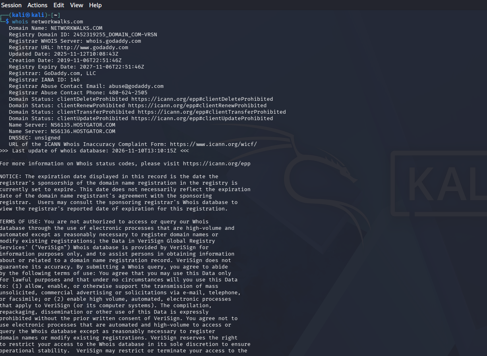

*Figure 1a: WHOIS output for networkwalks.com (Part 1).*

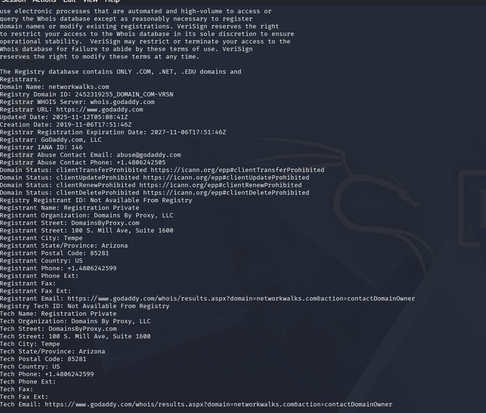

*Figure 1b: WHOIS output for networkwalks.com (Part 2).*

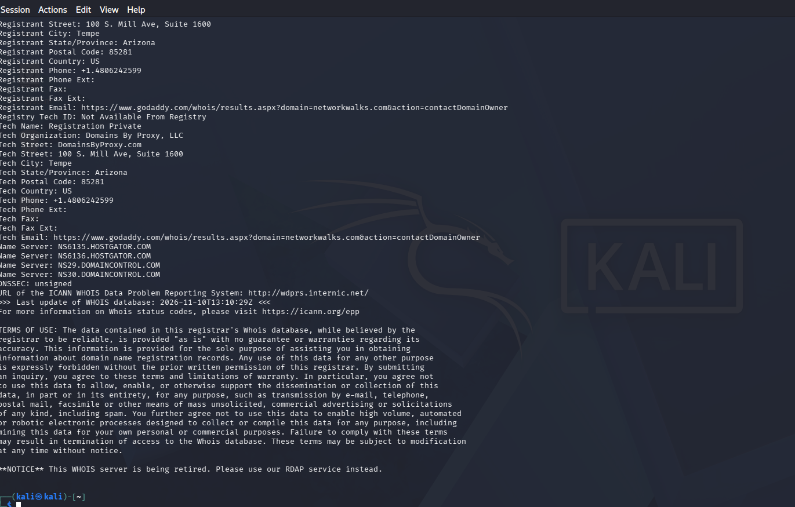

*Figure 1c: WHOIS output for networkwalks.com (Part 3).*

### Task 2 – WhatWeb

**Command:**

```bash
whatweb --open-timeout 30 --read-timeout 60 https://networkwalks.com
```

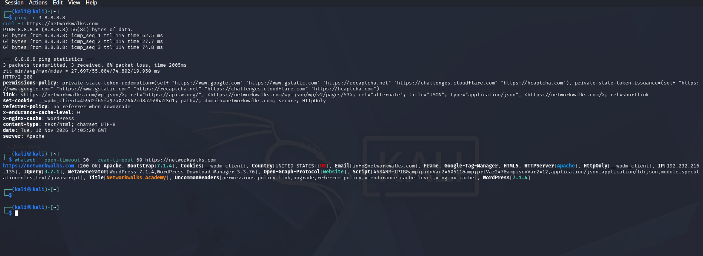

*Figure 2: WhatWeb website technology fingerprinting output.*

### Task 3 – Nslookup

**Command:**

```bash
nslookup networkwalks.com
```

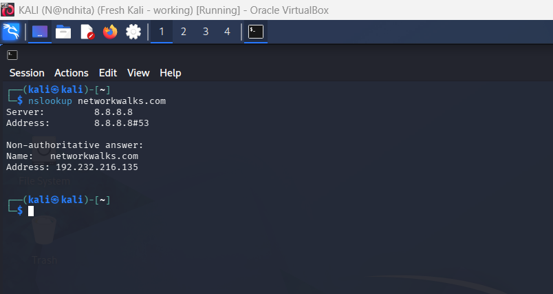

*Figure 3: Nslookup DNS resolution output.*

### Task 4 – Curl

**Command:**

```bash
curl -I https://networkwalks.com
```

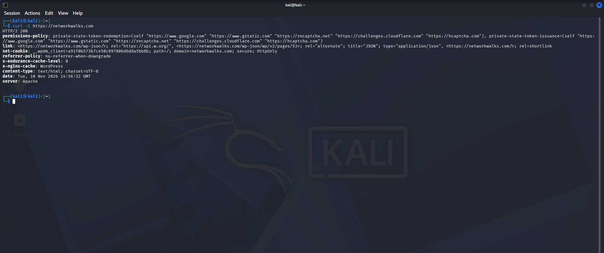

*Figure 4: Curl HTTP response headers.*

### Task 5 – Wafw00f

**Command:**

```bash
wafw00f networkwalks.com
```

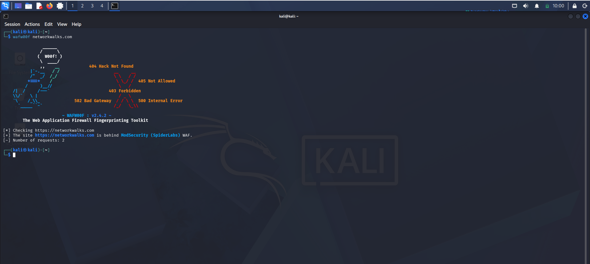

*Figure 5: Wafw00f Web Application Firewall detection output.*

### Task 6 – DNSRecon

**Command:**

```bash
dnsrecon -d networkwalks.com
```

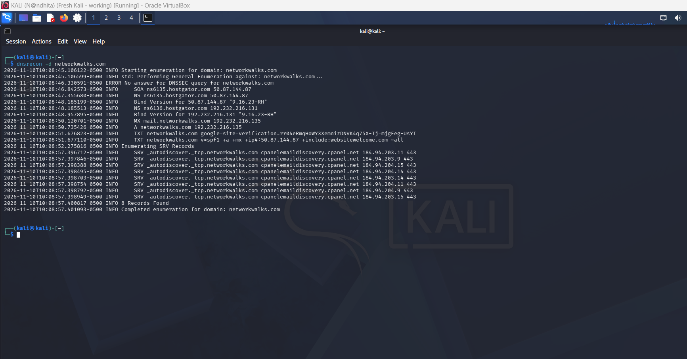

*Figure 6: DNSRecon DNS record enumeration output.*

## W2-PM4 – theHarvester Footprinting 🔒 🧩

### Task 1 – Baidu Source

**Command:**

```bash
theHarvester -d microsoft.com -l 1000 -b baidu
```

```text
[*] Target: microsoft.com
[*] Searching Baidu.
[*] No IPs found.
[*] Emails found: 2

msri-enquiries@microsoft.com

[*] No people found.
[*] Hosts found: 19

learn.microsoft.com
account.microsoft.com
cla.opensource.microsoft.com
copilot.microsoft.com
developer.microsoft.com
docs.microsoft.com
dotnet.microsoft.com
graph.microsoft.com
hxd.research.microsoft.com
o15.officeredir.microsoft.com
opensource.microsoft.com
prod.support.services.microsoft.com
s.windows.microsoft.com
spf-c.microsoft.com
support.microsoft.com
techcommunity.microsoft.com
ti.defender.microsoft.com

(and other hosts — 19 total)
```

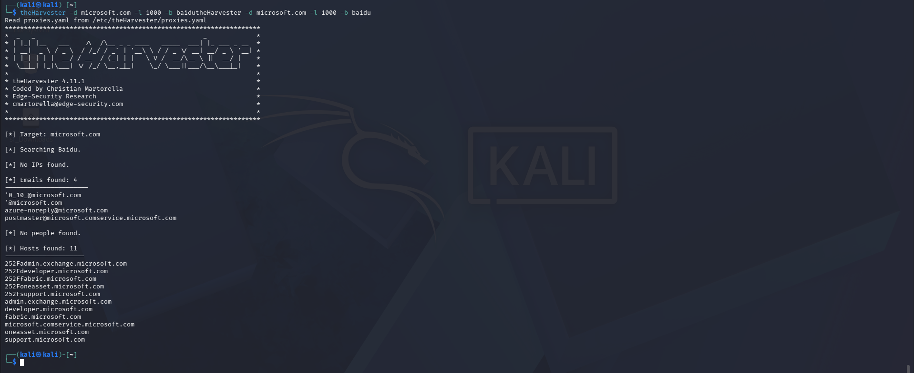

*Figure 9: theHarvester output using Baidu as the source (Task 1).*

### Task 2 – All Sources

**Command:**

```bash
theHarvester -d microsoft.com -l 50 -b all
```

**Observed output:**

```text
[*] Target: microsoft.com

[!] Missing API key for bevigil, Bitbucket, bufferoverun,
BuiltWith, Brave Search, Censys, criminalip, Dehashed,
DNSDumpster, fullhunt, Github, HaveIBeenPwned, Hunter,
hunterhow, Intelx, Netlas, onyphe, PentestTools,
ProjectDiscovery, RocketReach, SecurityScorecard,
Securitytrail, sherlockeye, Shodan, Tomba, Venacus,
virustotal, whoisxml, zoomeye

[*] Mojeek: No API key found, using default scraping mode.
[*] Searching Baidu.
[*] Searching Chaos.
[*] Searching Certspotter.

(scan continued querying remaining key-free sources)
```

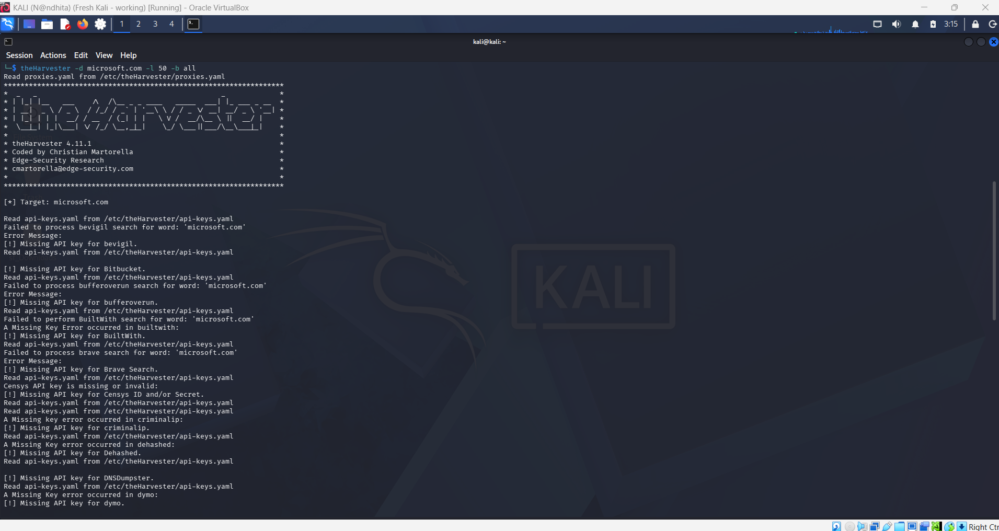

*Figure 10: theHarvester output using all available sources (Task 2). Several sources were skipped because API keys were not configured.*

## W2-PM5 – Zenmap Network Scanning ⚠️ 🔎

### Ping Scan

**Command:**

```bash
nmap -sn 10.213.143.0/24
```

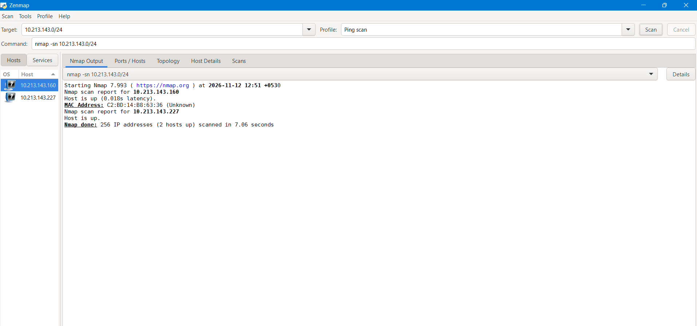

*Figure 11: Zenmap ping scan showing the discovered live hosts.*

### Windows IP Configuration 🔎

**Command:**

```cmd
ipconfig /all
```

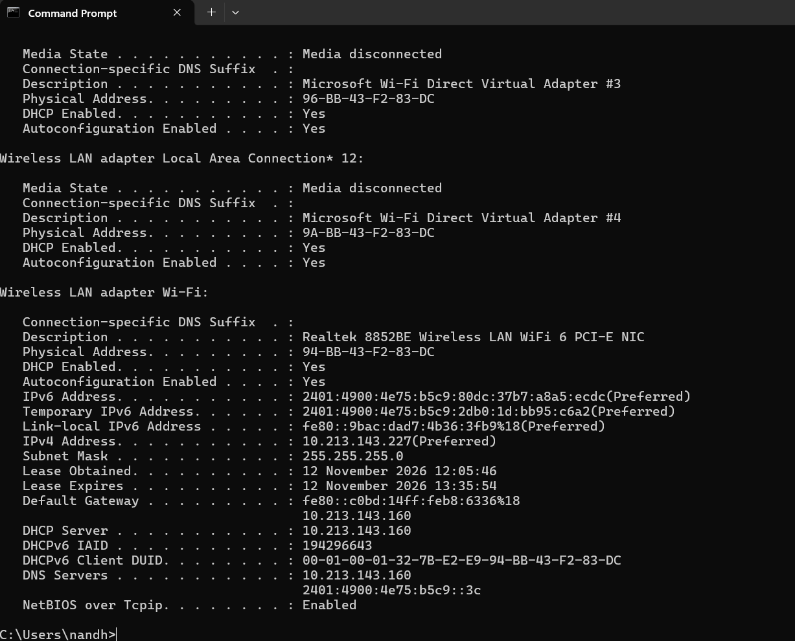

*Figure 12: Windows ipconfig /all output showing local IP configuration and MAC address.*

### Network Topology

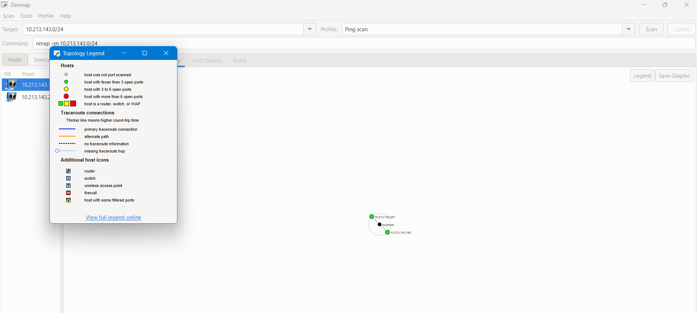

*Figure 13: Network topology generated using Zenmap.*

---

## 👤 Author / Project Information

**Prepared by:** Nandhita Mahato  
**Batch:** B084  
**Program:** Cybersecurity & Ethical Hacking Internship  
**Organization:** Networkwalks  
**Module:** W2-PM-FINAL – Footprinting & Network Scanning

❌ **End of Report** ❌
